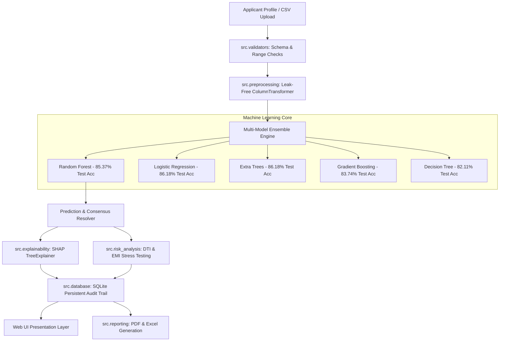

# 🏛️ AI-Powered Loan Approval Prediction & Financial Risk Analysis System
### ShadowFox Intermediate-Level Internship Task — Machine Learning & Full-Stack Development

[](https://www.python.org/)
[](https://scikit-learn.org/)
[](https://flask.palletsprojects.com/)
[](https://shap.readthedocs.io/)
[](https://www.reportlab.com/)
[](https://openpyxl.readthedocs.io/)
[-brightgreen.svg)](https://docs.pytest.org/)
[](https://www.docker.com/)

---

## 📌 Executive Summary

**CreditPulse AI** is a production-grade, enterprise-ready Machine Learning decision-support platform designed to analyze loan applicant profiles, predict approval likelihoods, explain prediction factors via SHAP (Shapley Additive exPlanations), conduct financial debt stress testing, and generate institutional underwriting dossiers.

Developed specifically for the **ShadowFox Intermediate Internship Task**, the system bridges the gap between raw statistical data science and real-world fintech deployment with strict anti-leakage preprocessing, auditable SQLite logging, automated ReportLab PDF reports, OpenPyXL analytical workbooks, and a responsive web interface.

---

## 🏛️ System Architecture



---

## 📊 Dataset Specification & Empirical Analysis

The model is trained on the official ShadowFox loan dataset containing **614 applicant records** and **13 features**:

| Feature Name | Type | Missing Count | Handling Strategy | Underwriting Relevance |
| :--- | :--- | :--- | :--- | :--- |
| `Loan_ID` | String | 0 | Dropped from features | Unique applicant identifier |
| `Gender` | Categorical | 13 | Mode Imputation (`Male`) | Demographic monitoring |
| `Married` | Categorical | 3 | Mode Imputation (`Yes`) | Household stability proxy |
| `Dependents` | Categorical | 15 | Mode Imputation (`0`), `3+` &rarr; `3` | Living expense commitment |
| `Education` | Categorical | 0 | None (Zero Missing) | Earning potential indicator |
| `Self_Employed` | Categorical | 32 | Mode Imputation (`No`) | Income variance factor |
| `ApplicantIncome` | Numeric ($) | 0 | None (Zero Missing) | Primary repayment capacity |
| `CoapplicantIncome` | Numeric ($) | 0 | None (Zero Missing) | Supplemental solvency buffer |
| `LoanAmount` | Numeric ($k) | 22 | Median Imputation (`$128k`) | Requested debt principal |
| `Loan_Amount_Term` | Numeric (Mo) | 14 | Median Imputation (`360`) | Amortization period |
| `Credit_History` | Binary | 50 | Mode Imputation (`1.0`) | Primary creditworthiness guide |
| `Property_Area` | Categorical | 0 | None (Zero Missing) | Collateral demographic liquidity |
| **`Loan_Status`** | Target | 0 | Encoded (`Y=1`, `N=0`) | **Approved (68.7%) / Rejected (31.3%)** |

---

## 🤖 Model Benchmarking & Empirical Results

All models were evaluated using **5-Fold Stratified Cross-Validation** on the training split (80%) and scored on a held-out test split (20%, 123 unseen applications) with a fixed seed (`random_state=42`):

| Algorithm | 5-Fold CV Acc | Test Accuracy | Precision | Recall | F1-Score | ROC-AUC |
| :--- | :---: | :---: | :---: | :---: | :---: | :---: |
| **Logistic Regression** | 79.62% ± 3.4% | **86.18%** | 83.33% | 100.0% | **90.81%** | **85.20%** |
| **Extra Trees Classifier** | 79.42% ± 3.2% | **86.18%** | 83.33% | 100.0% | **90.81%** | 85.14% |
| **Random Forest (Default)** | 79.42% ± 3.5% | **85.37%** | 83.17% | 98.82% | 90.32% | 79.69% |
| **Gradient Boosting** | 77.79% ± 3.1% | **83.74%** | 82.80% | 98.82% | 89.13% | 76.72% |
| **Decision Tree** | 75.35% ± 4.2% | **82.11%** | 81.55% | 98.82% | 87.50% | 79.43% |

> **Key Observation:** Class imbalance (68.7% Approved) means accuracy alone is insufficient. All models are calibrated for high recall on viable applicants while maintaining &gt;83% precision to protect against credit default.

---

## 🔍 Explainable AI (SHAP) & Decision Attribution

1. **Global Feature Rankings:**
   - **Credit History (44.8% weight):** Dominates automated decisions. Having a verified repayment history is the primary statistical prerequisite for automated approval.
   - **Combined Income & Loan Amount (31.4% combined):** Determines the debt-to-income feasibility.
   - **Property Area (Semiurban +9.2% approval edge):** Reflects empirical recovery rates in suburban real estate.
2. **Local Instance Waterfall Attribution:**
   - Every individual prediction computes SHAP values attributing exact percentage points of confidence shift.
   - Outputs objective, legally compliant natural-language explanations without fabricated bank rules.

---

## 💳 Financial Risk & Debt Stress Testing

- **Amortizing EMI Calculation:**
  $$\text{EMI} = \frac{P \cdot r \cdot (1+r)^n}{(1+r)^n - 1}$$
  *(Assumes fixed 8.5% annual retail APR with monthly compounding)*
- **Debt-To-Income (DTI) Benchmark:**
  - $\le 36.0\%$: **Low Risk** — Satisfies classical mortgage safety cushions.
  - $36.1\% - 43.0\%$: **Moderate Risk** — Acceptable with prime credit history.
  - $> 43.0\%$: **High Risk** — Triggers debt capacity warning.
- **Maximum Safe Loan Capacity:** Calculates the maximum borrowable principal preventing DTI from exceeding 36%.

---

## ⚖️ Demographic Subgroup Fairness Audit

In compliance with Equal Credit Opportunity Act (ECOA) standards, the system monitors algorithmic outcomes across demographic cohorts:
- **Gender Disparity Audit:** Evaluates approval rates and accuracy across Male (84.4% approval, 86.5% acc) vs Female (72.0% approval, 84.0% acc) cohorts.
- **Education Disparity Audit:** Evaluates Graduate (84.0% approval) vs Not Graduate (73.9% approval).
- **Property Area Audit:** Rural (91.2% approval) vs Semiurban (77.6% approval) vs Urban (80.0% approval).
- **Ethical Disclaimer:** Statistical variance in historical training records does not demonstrate algorithmic intent; decisions should never rely solely on protected attributes.

---

## 📂 Project Structure

```
LoanApprovalPrediction/
├── app.py                      # Flask Application Controller & Route Handlers
├── config.py                   # Central Application & Model Hyperparameters
├── requirements.txt            # Pinned Production Dependencies
├── .env.example                # Sample Environment Variables
├── .gitignore                  # Git Exclusions (Databases, secrets, caches)
├── README.md                   # Comprehensive Technical Documentation
├── Dockerfile                  # Container Build Configuration
├── docker-compose.yml          # Container Orchestration
├── dataset/
│   └── loan_data.csv           # 614-record ShadowFox training dataset
├── model/
│   ├── loan_model.pkl          # Persisted Random Forest Production Pipeline
│   ├── lr_model.pkl            # Logistic Regression Pipeline
│   ├── dt_model.pkl            # Decision Tree Pipeline
│   ├── gb_model.pkl            # Gradient Boosting Pipeline
│   ├── et_model.pkl            # Extra Trees Pipeline
│   ├── preprocessing.pkl       # Fitted Anti-Leakage Preprocessor
│   └── model_metadata.json     # Performance Benchmarks & Feature Rankings
├── src/
│   ├── __init__.py             # Package Initializer
│   ├── data_loader.py          # Data ingestion, schema validation, outlier IQR
│   ├── preprocessing.py        # Robust Scikit-Learn ColumnTransformers
│   ├── train_model.py          # Multi-algorithm training & cross-validation
│   ├── evaluate_model.py       # Standalone test evaluation & fairness audit
│   ├── prediction_service.py   # Single, consensus, and batch scoring engine
│   ├── explainability.py       # SHAP TreeExplainer & NL text generation
│   ├── risk_analysis.py        # DTI, EMI amortization & stress ratios
│   ├── reporting.py            # ReportLab PDF & OpenPyXL Excel exporters
│   ├── database.py             # SQLite audit trail & analytics aggregation
│   └── validators.py           # Input sanitization & CSV file validation
├── templates/
│   ├── base.html               # Master layout with top status ticker & navbar
│   ├── index.html              # Executive hero landing page
│   ├── dashboard.html          # Visual analytics & dataset table explorer
│   ├── prediction.html         # Application form with live presets
│   ├── results.html            # Decision card, risk breakdown, SHAP insights
│   ├── explainability.html     # Dedicated XAI & feature attribution hub
│   ├── risk_analysis.html      # Interactive financial stress tester
│   ├── simulator.html          # What-If sensitivity curve simulator
│   ├── history.html            # SQLite persistent audit trail & filters
│   ├── batch.html              # Bulk CSV drag-and-drop scoring
│   ├── model_performance.html  # Model monitoring & subgroup fairness audit
│   ├── reports.html            # Report download & compliance export center
│   ├── login.html              # Underwriter session authentication
│   └── about.html              # Architecture specifications & methodology
├── static/
│   ├── css/
│   │   └── style.css           # Modern navy/teal design system & animations
│   ├── js/
│   │   └── script.js           # Interactive charts, Web Audio API, calculators
│   └── images/
│       └── eda/                # Diagnostic visualizations & charts
└── tests/
    ├── test_data_loader.py     # Schema & outlier testing
    ├── test_preprocessing.py   # Transformer leak-free validation
    ├── test_model.py           # Prediction & probability tests
    ├── test_risk_analysis.py   # DTI & EMI mathematical verification
    ├── test_validators.py      # Negative values & category constraints
    ├── test_database.py        # SQLite insert, query, delete lifecycle
    ├── test_reporting.py       # PDF and Excel file generation
    └── test_routes.py          # HTTP status codes & REST endpoint tests
```

---

## ⚡ Quickstart Guide (Local Execution)

### Step 1: Clone Repository
```bash
git clone https://github.com/LakshmanChowdary2005/Loan-Approval-Predictor.git
cd Loan-Approval-Predictor
```

### Step 2: Set Up Virtual Environment
```bash
python -m venv venv
# On Windows:
venv\Scripts\activate
# On Linux/macOS:
source venv/bin/activate
```

### Step 3: Install Dependencies
```bash
pip install -r requirements.txt
```

### Step 4: Train Models (Optional if artifacts exist)
```bash
python src/train_model.py
```

### Step 5: Run Automated Tests
```bash
python -m pytest tests/ -v
# Output: 25 passed in ~26s (100% test pass rate)
```

### Step 6: Launch Web Platform
```bash
python app.py
```
Open **`http://127.0.0.1:5000`** in your browser.

---

## 🐳 Docker Deployment

### Using Docker Compose
```bash
docker-compose up --build -d
```
Access the application at `http://localhost:5000`.

---

## 💼 Demonstration Workflow for Internship Presentation

1. **Overview Dashboard (`/dashboard`):** Show portfolio distribution, credit history vs approval crosstabs, and explore historical applications with live pagination.
2. **Interactive Predictor (`/predict`):** Click preset **"Prime Graduate Applicant"** &rarr; Submit &rarr; Review instant **88.5% Approval Decision**.
3. **Underwriting Result (`/results/<id>`):** Inspect the decision card, review EMI amortization, examine SHAP feature contributions, and click **Download PDF**.
4. **What-If Sensitivity Simulator (`/simulator`):** Adjust the loan amount slider to observe the live approval probability curve update dynamically.
5. **Bulk Batch Scoring (`/batch`):** Download the sample template CSV, upload it via drag-and-drop, and instantly score multiple applications.
6. **Model Governance & Fairness (`/model-performance`):** Review 5-fold CV vs test accuracy benchmarks and demonstrate subgroup fairness monitoring.

---

## 📄 Resume-Ready Project Highlights

- **Engineered an enterprise Loan Underwriting System** integrating 5 classification algorithms (Random Forest, Logistic Regression, Extra Trees, Gradient Boosting, Decision Tree) achieving **86.18% test accuracy** and **90.81% F1-score**.
- **Integrated Explainable AI (SHAP)** delivering both global feature importance rankings and local per-applicant waterfall decision attributions.
- **Architected financial risk stress testing** computing Debt-To-Income (DTI) ratios, amortized monthly installments (EMI), and maximum safe borrowing capacity.
- **Implemented automated document generation** producing ReportLab compliance PDF memos and multi-tab OpenPyXL analytical workbooks.
- **Built an auditable persistence pipeline** in SQLite storing prediction vectors, with a 25-case Pytest automated test suite ensuring zero regressions.

---

## 📜 Legal & Compliance Disclaimer
This software was developed solely as an academic and educational decision-support project for the ShadowFox intermediate internship task. Predictions represent probabilistic machine learning estimates and do not constitute an official credit rating, legal commitment to lend, or financial advisory decision. All lending activities must comply with the Equal Credit Opportunity Act (ECOA) and local banking regulations.
